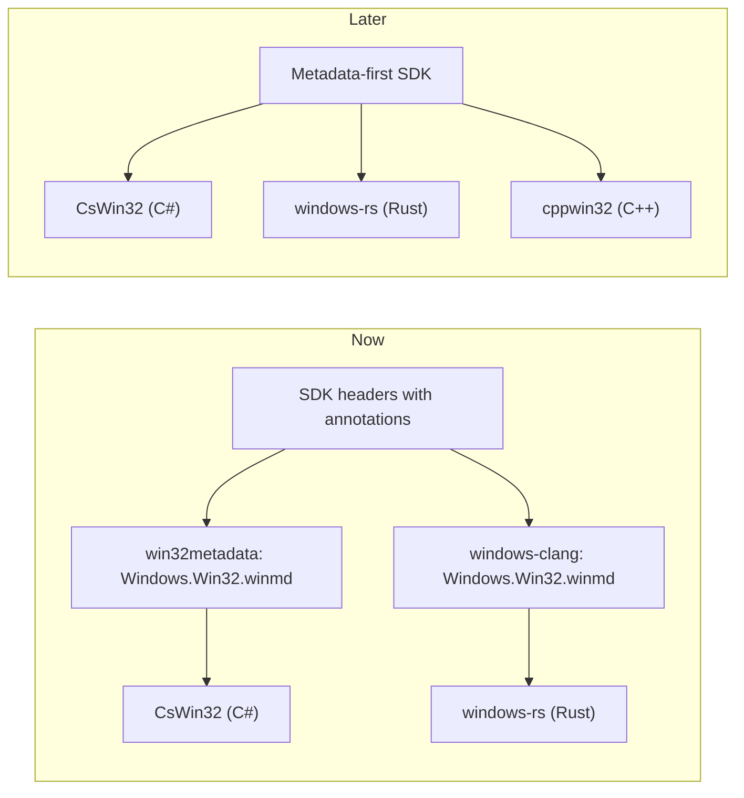
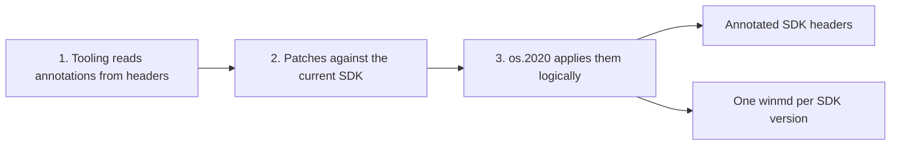

# Win32 metadata annotations in SDK headers

Plan of record for Windows SDK API owners: what changes in your headers, annotation by annotation, and the winmd each change produces. Slides: [sdk-owner-annotation-walkthrough.html](https://jevansaks.github.io/win32metadata/sdk-owner-annotation-walkthrough.html).

- Spec: [#2368](https://github.com/microsoft/win32metadata/pull/2368) (merged)
- Toolchain: [#2363](https://github.com/microsoft/win32metadata/pull/2363)
- Pilot: [#2365](https://github.com/microsoft/win32metadata/pull/2365), 13 headers and IDL files

Sample labels: **#2365** is verbatim from the pilot. **Illustrative** is written for this document against SDK 10.0.26100. **winmd** is the ILSpy view of the final winmd, trimmed.

## Context

Win32 metadata is a standard API definition with safety annotations.

- **A standard definition of the headers.** `Windows.Win32.winmd` describes every function, struct, enum, constant and COM interface in ECMA-335 metadata, as WinRT does, with its DLL and exact types. Projections read it instead of parsing C.
- **An expanded set of safety annotations.** What SAL doesn't say: last error, handle ownership, constant groups, retained pointers.



- **[win32metadata](https://github.com/microsoft/win32metadata)** builds it from the SDK headers and ships it on NuGet as [`Microsoft.Windows.SDK.Win32Metadata`](https://www.nuget.org/packages/Microsoft.Windows.SDK.Win32Metadata/). **[CsWin32](https://github.com/microsoft/CsWin32)** generates C# P/Invoke and COM interop from it.
- **[windows-rs](https://github.com/microsoft/windows-rs)** builds its own from the same headers with windows-clang for the `windows` and `windows-sys` crates.
- **For now**, headers stay the source of truth; annotations in them steer the metadata.
- **Later**, the SDK is metadata-first. C++ consumes it through [cppwin32](https://github.com/microsoft/cppwin32), which generates headers from it as C++/WinRT does for WinRT.

## Summary

Expanding safety annotations to cover what SAL doesn't.

What SAL doesn't cover today:

- **Last error.** Whether the function reports failure details through `GetLastError`.
- **Minimum OS.** The first Windows release with the API.
- **Import library.** The DLL, when no import library exports the function.
- **Handle ownership.** Who closes a returned handle, with what, and which values mean failure.
- **Constant groups.** Which named constants a `DWORD` parameter or field takes.
- **Pointer lifetimes.** Pointers the callee keeps; buffers that point into themselves.
- **COM return value.** Which out parameter is the logical result.

How:

- `_Win32_*_` annotations, placed like SAL. `sal.h` includes them.
- Active only under `WIN32METADATA` with Clang. Empty everywhere else: no ABI or codegen change.
- One winmd per SDK version, generated from that SDK's headers.
- Spec reviewed with partner teams ([#2295](https://github.com/microsoft/win32metadata/pull/2295), [#2368](https://github.com/microsoft/win32metadata/pull/2368)). [#2363](https://github.com/microsoft/win32metadata/pull/2363) extends it.

## The problem

Today the annotations are an afterthought. win32metadata adds them after the API ships, in sidecar files that API owners never see. CreateFileW: five sidecars in `generation/WinSDK` at `a1de5ac`:

```jsonc
// WithSetLastError.rsp:437
CreateFileW
// supportedOS.rsp:3284
CreateFileW=SupportedOSPlatform("windows5.1.2600")
// enums.json:2311
{ "name": "FILE_CREATION_DISPOSITION",
  "members": [ { "name": "CREATE_NEW", "value": "1" }, ... ],
  "uses": [ { "method": "CreateFileW",
              "parameter": "dwCreationDisposition" }, ... ] }
// enums.json:2362
{ "name": "FILE_SHARE_MODE", "flags": true, ...
  "uses": [ { "method": "CreateFileW",
              "parameter": "dwShareMode" }, ... ] }
// enums.json:6907
{ "addUsesTo": "FILE_FLAGS_AND_ATTRIBUTES", "flags": true,
  "uses": [ { "method": "CreateFileW",
              "parameter": "dwFlagsAndAttributes" }, ... ] }
// manual/FileSystem.cs:26 (hand-written C#)
[Flags] public enum FILE_FLAGS_AND_ATTRIBUTES : uint { ... }
// autoTypes.json:26 (every HANDLE, from every API)
{ "Name": "HANDLE", "CloseApi": "CloseHandle",
  "InvalidHandleValues": [ -1, 0 ], ... }
```

| Sidecar | Entries |
| --- | --- |
| [`WithSetLastError.rsp`](https://github.com/microsoft/win32metadata/blob/a1de5ac241651d4b4c7f533dd94184d83b5271c9/generation/WinSDK/WithSetLastError.rsp) | ~3,400 functions |
| [`supportedOS.rsp`](https://github.com/microsoft/win32metadata/blob/a1de5ac241651d4b4c7f533dd94184d83b5271c9/generation/WinSDK/supportedOS.rsp) | ~17,200 APIs |
| [`libMappingsManual.rsp`](https://github.com/microsoft/win32metadata/blob/a1de5ac241651d4b4c7f533dd94184d83b5271c9/generation/WinSDK/libMappingsManual.rsp) | ~400 functions |
| [`emitter.settings.rsp`](https://github.com/microsoft/win32metadata/blob/a1de5ac241651d4b4c7f533dd94184d83b5271c9/generation/WinSDK/emitter.settings.rsp) | 2,511 member fixups |
| [`scraper.settings.rsp`](https://github.com/microsoft/win32metadata/blob/a1de5ac241651d4b4c7f533dd94184d83b5271c9/generation/WinSDK/scraper.settings.rsp) | 727 lines |
| [`ConstantsScraper.settings.rsp`](https://github.com/microsoft/win32metadata/blob/a1de5ac241651d4b4c7f533dd94184d83b5271c9/generation/WinSDK/ConstantsScraper.settings.rsp) | 617 lines |
| [`autoTypes.json`](https://github.com/microsoft/win32metadata/blob/a1de5ac241651d4b4c7f533dd94184d83b5271c9/generation/WinSDK/autoTypes.json) | 444 typedefs |
| [`enums.json`](https://github.com/microsoft/win32metadata/blob/a1de5ac241651d4b4c7f533dd94184d83b5271c9/generation/WinSDK/enums.json) | 1,072 enums |

`autoTypes.json` states one close function and one set of failure values for every `HANDLE` from every API.

## The plan

Three steps from sidecars to annotated SDK headers.



1. **Expand the tooling.** win32metadata reads annotations out of the headers as well as the sidecars ([#2363](https://github.com/microsoft/win32metadata/pull/2363)).
2. **Patch the current SDK.** A set of patches moves the sidecar facts into the SDK headers and IDL. [#2365](https://github.com/microsoft/win32metadata/pull/2365) is the pilot: 13 headers and IDL files.
3. **Transport into os.2020.** Each patch is applied logically to the source that generates the header: `.w`, `.h`, `.api`/`.apx` or `.idl`.

## Ground rules

Annotations describe the API as it ships.

- **State what's true today.** An annotation never changes behavior or the ABI.
- **Native form first.** SAL, MIDL `[retval]`, `[[deprecated]]`, `enum class` where the API is already scoped, `[[clang::flag_enum]]`. A `_Win32_*_` macro only where C and C++ have no form.
- **Facts belong to the API.** Failure values, ownership and enum associations go on the function, parameter or field they describe, not on a shared type.
- **Native types stay native.** A `DWORD` stays a `DWORD` with an associated enum. No invented handle types.
- **Validation is strict.** Duplicate, misplaced or malformed annotations fail generation.

Not carried forward:

| win32metadata today | Plan |
| --- | --- |
| `Agile` | Dropped. The thread-safety claim isn't reliable. |
| `DoNotRelease`, `FreeWith` | No `RAIIFree` means borrowed. Allocations carry `RAIIFree` on the producer. |
| `NativeArrayInfo`, `MemorySize`, `NotNullTerminated` | Derived from SAL. Still in the winmd. |
| `IgnoreIfReturn`, `NativeInheritance`, `ProjectAs`, `NativeEncoding`, `CanonicalName`, `ReducePointerLevel` | Dropped. |
| APIs removed from the SDK | Omitted. Older winmds keep them. |

## Annotation reference

Where each annotation goes and what it becomes in the winmd.

| Annotation | Goes on | winmd |
| --- | --- | --- |
| [`_Win32_SetLastError_`](#createfilew) | functions | `SetLastError = true` |
| [`_Win32_SupportedOS_<OS>_`](#supportedos), `_Win32_SupportedOS_BEGIN_(<OS>)` … `_Win32_SupportedOS_END_()` | any declaration, or a region | `[SupportedOSPlatform]` |
| [`_Win32_ImportLibrary_("dll"[, export])`](#importlibrary) | functions the import-library scan can't map | `DllImport("dll")` |
| [`_Win32_RAIIFree_(close, invalid...)`](#raiifree-and-alsousablefor), `_Win32_RAIIFree_Handle_(close)` | handle-returning functions, handle out parameters | `[RAIIFree]`, `[InvalidHandleValue]` |
| [`_Win32_AlsoUsableFor_(type)`](#raiifree-and-alsousablefor) | handle typedefs | `[AlsoUsableFor]` |
| [`_Win32_Enum_(name, storage, ...)`](#enum-flagsenum-and-associatedenum), `_Win32_FlagsEnum_(...)` | groups of `#define` constants | `[ScopedEnum] enum`, `[ScopedEnum] [Flags] enum` |
| [`_Win32_AssociatedEnum_(name)`](#enum-flagsenum-and-associatedenum) | parameters, fields, return values | `[AssociatedEnum]` on the native type |
| [`_Win32_AssociatedConstant_(name)`](#associatedconstant) | enum groups | `[AssociatedConstant]` |
| [`_Win32_PreserveResult_`](#preserveresult) | functions, COM methods | `[PreserveSig]` |
| [`_Win32_Retained_`](#containsinteriorpointers-and-retained) | pointer parameters | `[Retained]` |
| [`_Win32_ContainsInteriorPointers_`](#containsinteriorpointers-and-retained) | caller-owned buffers | `[ContainsInteriorPointers]` |
| [`[retval]`](#annotateinterface-and-annotatemethod), `_Win32_Retval_` | COM out parameters (IDL, C++) | `[RetVal]` |
| [`_Win32_AnnotateInterface_`](#annotateinterface-and-annotatemethod), `_Win32_AnnotateMethod_` | IDL, outside the interface body | the wrapped annotation |
| [`[[deprecated]]`](#typed-constants-and-deprecated-fields) | fields, guarded by `WIN32METADATA` | `[Obsolete]` |

## Annotations by example

### CreateFileW

CreateFileW, fully annotated.

`um/fileapi.h`, illustrative:

```diff
 #define CREATE_NEW          1
...
 #define TRUNCATE_EXISTING   5
+_Win32_Enum_(FILE_CREATION_DISPOSITION, DWORD, CREATE_NEW, CREATE_ALWAYS,
+    OPEN_EXISTING, OPEN_ALWAYS, TRUNCATE_EXISTING);
...
 WINBASEAPI
+_Win32_SupportedOS_WindowsXP_
+_Win32_SetLastError_
+_Win32_RAIIFree_(CloseHandle, -1)
 HANDLE
 WINAPI
 CreateFileW(
     _In_ LPCWSTR lpFileName,
     _In_ DWORD dwDesiredAccess,
-    _In_ DWORD dwShareMode,
+    _In_ _Win32_AssociatedEnum_(FILE_SHARE_MODE) DWORD dwShareMode,
     _In_opt_ LPSECURITY_ATTRIBUTES lpSecurityAttributes,
-    _In_ DWORD dwCreationDisposition,
-    _In_ DWORD dwFlagsAndAttributes,
+    _In_ _Win32_AssociatedEnum_(FILE_CREATION_DISPOSITION) DWORD dwCreationDisposition,
+    _In_ _Win32_AssociatedEnum_(FILE_FLAGS_AND_ATTRIBUTES) DWORD dwFlagsAndAttributes,
     _In_opt_ HANDLE hTemplateFile
     );
```

`um/winnt.h`, illustrative:

```diff
 #define FILE_SHARE_READ                 0x00000001
 #define FILE_SHARE_WRITE                0x00000002
 #define FILE_SHARE_DELETE               0x00000004
+_Win32_FlagsEnum_(FILE_SHARE_MODE, DWORD,
+    FILE_SHARE_READ, FILE_SHARE_WRITE, FILE_SHARE_DELETE);
```

`um/winbase.h`, illustrative:

```diff
 #define SECURITY_SQOS_PRESENT      0x00100000
 #define SECURITY_VALID_SQOS_FLAGS  0x001F0000
+_Win32_FlagsEnum_(FILE_FLAGS_AND_ATTRIBUTES, DWORD,
+    FILE_ATTRIBUTE_READONLY, FILE_ATTRIBUTE_HIDDEN,
...
+    FILE_FLAG_WRITE_THROUGH, FILE_FLAG_OVERLAPPED,
...
+    PIPE_ACCESS_INBOUND, PIPE_ACCESS_OUTBOUND,
...
+    SECURITY_SQOS_PRESENT, SECURITY_VALID_SQOS_FLAGS);
```

winmd:

```cs
[DllImport("KERNEL32.dll", ExactSpelling = true,
    PreserveSig = false, SetLastError = true)]
[SupportedOSPlatform("windows5.1.2600")]
[return: RAIIFree("CloseHandle")]
[return: InvalidHandleValue(-1L)]
public static extern HANDLE CreateFileW(
    [In][Const] PWSTR lpFileName,
    [In] uint dwDesiredAccess,
    [In][AssociatedEnum("FILE_SHARE_MODE")] uint dwShareMode,
    [Optional][In] SECURITY_ATTRIBUTES* lpSecurityAttributes,
    [In][AssociatedEnum("FILE_CREATION_DISPOSITION")]
        uint dwCreationDisposition,
    [In][AssociatedEnum("FILE_FLAGS_AND_ATTRIBUTES")]
        uint dwFlagsAndAttributes,
    [Optional][In] HANDLE hTemplateFile);
```

- Replaces every [sidecar entry](#the-problem) for CreateFileW.

### CreateToolhelp32Snapshot

SetLastError, SupportedOS and FlagsEnum in the pilot.

`um/TlHelp32.h`, [#2365](https://github.com/microsoft/win32metadata/pull/2365):

```diff
+#ifdef WIN32METADATA
+typedef DWORD CREATE_TOOLHELP_SNAPSHOT_FLAGS;
+#endif
+
+_Win32_SupportedOS_WindowsXP_
+_Win32_SetLastError_
 HANDLE
 WINAPI
 CreateToolhelp32Snapshot(
-    DWORD dwFlags,
+    _Win32_AssociatedEnum_(CREATE_TOOLHELP_SNAPSHOT_FLAGS) DWORD dwFlags,
     DWORD th32ProcessID
     );
...
 #define TH32CS_SNAPMODULE32 0x00000010
 #define TH32CS_SNAPALL      (TH32CS_SNAPHEAPLIST | TH32CS_SNAPPROCESS | TH32CS_SNAPTHREAD | TH32CS_SNAPMODULE)
 #define TH32CS_INHERIT      0x80000000
+
+_Win32_FlagsEnum_(CREATE_TOOLHELP_SNAPSHOT_FLAGS, DWORD,
+    TH32CS_INHERIT,
+    TH32CS_SNAPALL,
+    TH32CS_SNAPHEAPLIST,
+    TH32CS_SNAPMODULE,
+    TH32CS_SNAPMODULE32,
+    TH32CS_SNAPPROCESS,
+    TH32CS_SNAPTHREAD);
+
```

winmd:

```cs
[DllImport("KERNEL32.dll", ExactSpelling = true,
    PreserveSig = false, SetLastError = true)]
[SupportedOSPlatform("windows5.1.2600")]
public static extern HANDLE CreateToolhelp32Snapshot(
    [In][AssociatedEnum("CREATE_TOOLHELP_SNAPSHOT_FLAGS")]
        uint dwFlags,
    [In] uint th32ProcessID);

[ScopedEnum]
[Flags]
public enum CREATE_TOOLHELP_SNAPSHOT_FLAGS : uint
{
    TH32CS_INHERIT = 0x80000000u,
    TH32CS_SNAPALL = 0xFu,
    TH32CS_SNAPHEAPLIST = 1u,
    TH32CS_SNAPMODULE = 8u,
    TH32CS_SNAPMODULE32 = 0x10u,
    TH32CS_SNAPPROCESS = 2u,
    TH32CS_SNAPTHREAD = 4u
}
```

- The group is used before its `#define`s, so it's forward-declared under `WIN32METADATA`.
- Ownership still comes from `autoTypes.json` in the pilot. Annotated, it's `_Win32_RAIIFree_(CloseHandle, -1)`, as on [CreateFileW](#createfilew).

### SupportedOS

Minimum OS, per declaration or per region.

`um/timezoneapi.h`, [#2365](https://github.com/microsoft/win32metadata/pull/2365):

```diff
 WINBASEAPI
 _Success_(return != FALSE)
+_Win32_SupportedOS_Windows2000_
+_Win32_SetLastError_
 BOOL
 WINAPI
 SystemTimeToTzSpecificLocalTime(
...
     _Out_ LPSYSTEMTIME lpLocalTime
     );
```

`um/magnification.h`, [#2365](https://github.com/microsoft/win32metadata/pull/2365):

```diff
+_Win32_SupportedOS_BEGIN_(WindowsVista)
 BOOL WINAPI MagInitialize();
...
 BOOL WINAPI MagGetColorEffect(HWND hwnd, PMAGCOLOREFFECT pEffect);
+_Win32_SupportedOS_END_()
+_Win32_SupportedOS_BEGIN_(Windows8)
 BOOL WINAPI MagSetFullscreenTransform(_In_ float magLevel, _In_ int xOffset, _In_ int yOffset);
...
+_Win32_SetLastError_
 BOOL WINAPI MagSetInputTransform(_In_ BOOL fEnabled, _In_ const LPRECT pRectSource, _In_ const LPRECT pRectDest);
...
+_Win32_SupportedOS_END_()
```

winmd:

```cs
[DllImport("KERNEL32.dll", ExactSpelling = true,
    PreserveSig = false, SetLastError = true)]
[SupportedOSPlatform("windows5.0")]
public static extern BOOL SystemTimeToTzSpecificLocalTime(
    [Optional][In][Const]
        TIME_ZONE_INFORMATION* lpTimeZoneInformation,
    [In][Const] SYSTEMTIME* lpUniversalTime,
    [Out] SYSTEMTIME* lpLocalTime);

[DllImport("MAGNIFICATION.dll", ExactSpelling = true,
    PreserveSig = false)]
[SupportedOSPlatform("windows6.0.6000")]
public static extern BOOL MagInitialize();

[DllImport("MAGNIFICATION.dll", ExactSpelling = true,
    PreserveSig = false, SetLastError = true)]
[SupportedOSPlatform("windows8.0")]
public static extern BOOL MagSetInputTransform(
    [In] BOOL fEnabled,
    [In][Const] RECT* pRectSource,
    [In][Const] RECT* pRectDest);
```

The OS is part of the macro name, from a fixed menu. A new release adds a macro.

| Macro | winmd |
| --- | --- |
| `_Win32_SupportedOS_Windows2000_` | `windows5.0` |
| `_Win32_SupportedOS_WindowsXP_` | `windows5.1.2600` |
| `_Win32_SupportedOS_WindowsVista_` | `windows6.0.6000` |
| `_Win32_SupportedOS_Windows7_` | `windows6.1` |
| `_Win32_SupportedOS_Windows8_` | `windows8.0` |
| `_Win32_SupportedOS_Windows81_` | `windows8.1` |
| `_Win32_SupportedOS_<build>_`: 10240, 10586, 14393, 15063, 16299, 17134, 17763, 18362, 19041 | `windows10.0.<build>` |
| `_Win32_SupportedOS_Server<year>_`: 2000, 2003, 2008, 2012, 2016 | `windowsserver<year>` |

### ImportLibrary

DLL names for functions with no import library.

`um/wslapi.h`, [#2365](https://github.com/microsoft/win32metadata/pull/2365):

```diff
 /* Determines if a distribution is already registered */
+_Win32_ImportLibrary_("Api-ms-win-wsl-api-l1-1-0.dll")
 BOOL
 WslIsDistributionRegistered(
     _In_ PCWSTR distributionName
     );
```

`um/avrfsdk.h`, [#2365](https://github.com/microsoft/win32metadata/pull/2365):

```diff
 #define AVRF_ENUM_RESOURCES_FLAGS_SUSPEND             0x00000001
 #define AVRF_ENUM_RESOURCES_FLAGS_DONT_RESOLVE_TRACES 0x00000002

+
+_Win32_FlagsEnum_(VERIFIER_ENUM_RESOURCE_FLAGS, ULONG,
+    AVRF_ENUM_RESOURCES_FLAGS_DONT_RESOLVE_TRACES,
+    AVRF_ENUM_RESOURCES_FLAGS_SUSPEND);
+
+_Win32_ImportLibrary_("verifier.dll")
 ULONG NTAPI
 VerifierEnumerateResource(
     HANDLE Process,
-    ULONG  Flags,
-    ULONG  ResourceType,
+    _Win32_AssociatedEnum_(VERIFIER_ENUM_RESOURCE_FLAGS) ULONG  Flags,
+    _Win32_AssociatedEnum_(enum eAvrfResourceTypes) ULONG  ResourceType,
     AVRF_RESOURCE_ENUMERATE_CALLBACK ResourceCallback,
     PVOID  EnumerationContext
     );
```

winmd:

```cs
[DllImport("Api-ms-win-wsl-api-l1-1-0.dll",
    ExactSpelling = true, PreserveSig = false)]
public static extern BOOL WslIsDistributionRegistered(
    [In][Const] PWSTR distributionName);

[DllImport("verifier.dll", ExactSpelling = true,
    PreserveSig = false)]
public static extern uint VerifierEnumerateResource(
    [In] HANDLE Process,
    [In][AssociatedEnum("VERIFIER_ENUM_RESOURCE_FLAGS")]
        uint Flags,
    [In][AssociatedEnum("eAvrfResourceTypes")]
        uint ResourceType,
    [In] AVRF_RESOURCE_ENUMERATE_CALLBACK ResourceCallback,
    [In][Out] void* EnumerationContext);
```

- No import library in SDK 10.0.26100 exports either function.
- `VerifierEnumerateResource` is [documented](https://learn.microsoft.com/en-us/windows/win32/api/avrfsdk/nf-avrfsdk-verifierenumerateresource) as having no import library; callers use `LoadLibrary` and `GetProcAddress`. The annotation records that in the header.
- Different export name or ordinal: `_Win32_ImportLibrary_("dll", "Export")`, `_Win32_ImportLibrary_("dll", 12)`.
- Replaces `--with-librarypath` in [`scraper.settings.rsp` line 4](https://github.com/microsoft/win32metadata/blob/a1de5ac241651d4b4c7f533dd94184d83b5271c9/generation/WinSDK/scraper.settings.rsp#L4) and [`Partitions/Wsl/settings.rsp` lines 4–10](https://github.com/microsoft/win32metadata/blob/a1de5ac241651d4b4c7f533dd94184d83b5271c9/generation/WinSDK/Partitions/Wsl/settings.rsp#L4-L10).

### RAIIFree and AlsoUsableFor

Ownership goes on each function that produces a handle.

`um/synchapi.h`, illustrative:

```diff
 WINBASEAPI
 _Ret_maybenull_
+_Win32_RAIIFree_(CloseHandle, 0)
 HANDLE
 WINAPI
 CreateEventW(
```

`um/libloaderapi.h`, illustrative:

```diff
 WINBASEAPI
 _Ret_maybenull_
+_Win32_RAIIFree_(FreeLibrary, 0)
 HMODULE
 WINAPI
 LoadLibraryExW(
```

`shared/minwindef.h`, illustrative:

```diff
 DECLARE_HANDLE(HINSTANCE);
+_Win32_AlsoUsableFor_(HINSTANCE)
 typedef HINSTANCE HMODULE;      /* HMODULEs can be used in place of HINSTANCEs */
```

winmd today:

```cs
[RAIIFree("CloseHandle")]
[InvalidHandleValue(-1L)]
[InvalidHandleValue(0L)]
[NativeTypedef]
public struct HANDLE { public void* Value; }

[return: DoNotRelease]
public static extern HANDLE GetProcessHeap();
```

winmd after, illustrative:

```cs
[NativeTypedef]
public struct HANDLE { public void* Value; }

[return: RAIIFree("CloseHandle")]
[return: InvalidHandleValue(0L)]
public static extern HANDLE CreateEventW(...);

[return: RAIIFree("FreeLibrary")]
[return: InvalidHandleValue(0L)]
public static extern HMODULE LoadLibraryExW(...);

[AlsoUsableFor("HINSTANCE")]
[NativeTypedef]
public struct HMODULE { public void* Value; }

// No RAIIFree: borrowed
public static extern HANDLE GetProcessHeap();
```

- Failure values are per API: `-1` for `CreateFileW`, `0` for `CreateEventW` and `LoadLibraryExW`.
- No `RAIIFree` means borrowed. `_Win32_RAIIFree_Handle_(close)` is `(close, -1, 0)`.

### Enum, FlagsEnum and AssociatedEnum

Constant groups become enums linked to the parameters that take them.

`um/magnification.h`, [#2365](https://github.com/microsoft/win32metadata/pull/2365):

```diff
 #define MW_FILTERMODE_EXCLUDE   0
 #define MW_FILTERMODE_INCLUDE   1

+_Win32_Enum_(MW_FILTERMODE, DWORD,
+    MW_FILTERMODE_EXCLUDE,
+    MW_FILTERMODE_INCLUDE);
...
-BOOL WINAPI MagSetWindowFilterList(HWND hwnd, DWORD dwFilterMode, int count, HWND *pHWND );
-int  WINAPI MagGetWindowFilterList(HWND hwnd, DWORD *pdwFilterMode, int count, HWND *pHWND );
+BOOL WINAPI MagSetWindowFilterList(HWND hwnd, _Win32_AssociatedEnum_(MW_FILTERMODE) DWORD dwFilterMode, int count, HWND *pHWND );
+int  WINAPI MagGetWindowFilterList(HWND hwnd, _Win32_AssociatedEnum_(MW_FILTERMODE) DWORD *pdwFilterMode, int count, HWND *pHWND );
```

winmd:

```cs
[ScopedEnum]
public enum MW_FILTERMODE : uint
{
    MW_FILTERMODE_EXCLUDE,
    MW_FILTERMODE_INCLUDE
}

[DllImport("MAGNIFICATION.dll", ExactSpelling = true,
    PreserveSig = false)]
[SupportedOSPlatform("windows6.0.6000")]
public static extern BOOL MagSetWindowFilterList(
    [In] HWND hwnd,
    [In][AssociatedEnum("MW_FILTERMODE")] uint dwFilterMode,
    [In] int count,
    [In][Out] HWND* pHWND);
```

- `_Win32_Enum_(name, storage, members...)` becomes a scoped enum. `storage` is the native type and sets its width.
- `AssociatedEnum` names the group, including on out pointers.
- Existing C enums: `_Win32_AssociatedEnum_(enum VARENUM)`.

### AssociatedConstant

Three enums share `SERVICE_NO_CHANGE`, so it stays global.

`um/winnt.h`, illustrative:

```diff
 #define SERVICE_BOOT_START             0x00000000
 #define SERVICE_SYSTEM_START           0x00000001
 #define SERVICE_AUTO_START             0x00000002
 #define SERVICE_DEMAND_START           0x00000003
 #define SERVICE_DISABLED               0x00000004
+_Win32_AssociatedConstant_(SERVICE_NO_CHANGE)
+_Win32_Enum_(SERVICE_START_TYPE, DWORD,
+    SERVICE_BOOT_START, SERVICE_SYSTEM_START, SERVICE_AUTO_START,
+    SERVICE_DEMAND_START, SERVICE_DISABLED);
```

`um/winsvc.h`, illustrative:

```diff
 ChangeServiceConfigW(
     _In_        SC_HANDLE    hService,
-    _In_        DWORD        dwServiceType,
-    _In_        DWORD        dwStartType,
-    _In_        DWORD        dwErrorControl,
+    _In_ _Win32_AssociatedEnum_(ENUM_SERVICE_TYPE) DWORD dwServiceType,
+    _In_ _Win32_AssociatedEnum_(SERVICE_START_TYPE) DWORD dwStartType,
+    _In_ _Win32_AssociatedEnum_(SERVICE_ERROR) DWORD dwErrorControl,
```

winmd:

```cs
[ScopedEnum]
[AssociatedConstant("SERVICE_NO_CHANGE")]
public enum SERVICE_START_TYPE : uint
{
    SERVICE_BOOT_START,
    SERVICE_SYSTEM_START,
    SERVICE_AUTO_START,
    SERVICE_DEMAND_START,
    SERVICE_DISABLED
}

public static extern BOOL ChangeServiceConfigW(
    [In] SC_HANDLE hService,
    [In][AssociatedEnum("ENUM_SERVICE_TYPE")] uint dwServiceType,
    [In][AssociatedEnum("SERVICE_START_TYPE")] uint dwStartType,
    [In][AssociatedEnum("SERVICE_ERROR")] uint dwErrorControl,
    ...);
```

`ENUM_SERVICE_TYPE` and `SERVICE_ERROR` carry the same annotation. CsWin32 emits it as a member of each: `SERVICE_START_TYPE.SERVICE_NO_CHANGE`.

### AssociatedEnum on fields

BYTE and WORD fields link to enums of the same width.

`um/Xinput.h`, illustrative:

```diff
+_Win32_Enum_(XINPUT_DEVTYPE, BYTE,
+    XINPUT_DEVTYPE_GAMEPAD);
...
+_Win32_FlagsEnum_(XINPUT_CAPABILITIES_FLAGS, WORD,
+    XINPUT_CAPS_VOICE_SUPPORTED,
+    XINPUT_CAPS_FFB_SUPPORTED,
+    XINPUT_CAPS_WIRELESS,
+    XINPUT_CAPS_PMD_SUPPORTED,
+    XINPUT_CAPS_NO_NAVIGATION);
...
 typedef struct _XINPUT_CAPABILITIES
 {
+    _Win32_AssociatedEnum_(XINPUT_DEVTYPE)
     BYTE                                Type;
+    _Win32_AssociatedEnum_(XINPUT_DEVSUBTYPE)
     BYTE                                SubType;
+    _Win32_AssociatedEnum_(XINPUT_CAPABILITIES_FLAGS)
     WORD                                Flags;
     XINPUT_GAMEPAD                      Gamepad;
     XINPUT_VIBRATION                    Vibration;
 } XINPUT_CAPABILITIES, *PXINPUT_CAPABILITIES;
```

winmd:

```cs
[ScopedEnum]
public enum XINPUT_DEVTYPE : byte
{
    XINPUT_DEVTYPE_GAMEPAD = 1
}

[ScopedEnum]
[Flags]
public enum XINPUT_CAPABILITIES_FLAGS : ushort
{
    XINPUT_CAPS_VOICE_SUPPORTED = 4,
    XINPUT_CAPS_FFB_SUPPORTED = 1,
    XINPUT_CAPS_WIRELESS = 2,
    XINPUT_CAPS_PMD_SUPPORTED = 8,
    XINPUT_CAPS_NO_NAVIGATION = 0x10
}

public struct XINPUT_CAPABILITIES
{
    [AssociatedEnum("XINPUT_DEVTYPE")]
    public byte Type;
    [AssociatedEnum("XINPUT_DEVSUBTYPE")]
    public byte SubType;
    [AssociatedEnum("XINPUT_CAPABILITIES_FLAGS")]
    public ushort Flags;
    public XINPUT_GAMEPAD Gamepad;
    public XINPUT_VIBRATION Vibration;
}
```

### PreserveResult

Non-obvious HRESULT returns.

`um/propidlbase.idl`, [#2365](https://github.com/microsoft/win32metadata/pull/2365):

```diff
 typedef [unique] IPropertyStorage * LPPROPERTYSTORAGE;

+_Win32_AnnotateMethod_(IEnumSTATPROPSTG::Next, _Win32_PreserveResult_)
+_Win32_AnnotateMethod_(IEnumSTATPROPSTG::Skip, _Win32_PreserveResult_)
+_Win32_AnnotateMethod_(IEnumSTATPROPSETSTG::Next, _Win32_PreserveResult_)
+_Win32_AnnotateMethod_(IEnumSTATPROPSETSTG::Skip, _Win32_PreserveResult_)
```

`um/ole2.h`, illustrative:

```diff
 WINOLEAPI  RevokeDragDrop(IN HWND hwnd);
+_Win32_PreserveResult_
 WINOLEAPI  DoDragDrop(IN LPDATAOBJECT pDataObj, IN LPDROPSOURCE pDropSource,
             IN DWORD dwOKEffects, OUT LPDWORD pdwEffect);
```

winmd:

```cs
public interface IEnumSTATPROPSTG : IUnknown
{
    [PreserveSig]
    HRESULT Next([In] uint celt,
        [Out][NativeArrayInfo(CountParamIndex = 0)]
            STATPROPSTG* rgelt,
        [Optional][Out] uint* pceltFetched);

    [PreserveSig]
    HRESULT Skip([In] uint celt);

    HRESULT Reset();
    HRESULT Clone([Out] IEnumSTATPROPSTG* ppenum);
}

// No PreserveSig = false: DRAGDROP_S_* reach the caller
[DllImport("OLE32.dll", ExactSpelling = true)]
[SupportedOSPlatform("windows5.0")]
public static extern HRESULT DoDragDrop(...);
```

- `S_FALSE` from `Next` and `Skip`, and `DRAGDROP_S_*` from `DoDragDrop`, reach the caller instead of collapsing to success.
- So do expected failures, like `DXGI_ERROR_NOT_FOUND` from `IDXGIFactory1::EnumAdapters1` past the last adapter.
- Replaces `[CanReturnMultipleSuccessValues]` ([405](https://github.com/microsoft/win32metadata/blob/a1de5ac241651d4b4c7f533dd94184d83b5271c9/generation/WinSDK/emitter.settings.rsp#L405), [446–447](https://github.com/microsoft/win32metadata/blob/a1de5ac241651d4b4c7f533dd94184d83b5271c9/generation/WinSDK/emitter.settings.rsp#L446-L447)) and `[CanReturnErrorsAsSuccess]` ([1014](https://github.com/microsoft/win32metadata/blob/a1de5ac241651d4b4c7f533dd94184d83b5271c9/generation/WinSDK/emitter.settings.rsp#L1014)) in `emitter.settings.rsp`.

### AnnotateInterface and AnnotateMethod

MIDL doesn't carry annotations into headers faithfully.

`um/waasapi.idl`, [#2365](https://github.com/microsoft/win32metadata/pull/2365):

```diff
 cpp_quote("#include <winapifamily.h>")
+#include <sal.h>
...
 import "WaaSAPITypes.idl";

+_Win32_AnnotateInterface_(IWaaSAssessor, _Win32_SupportedOS_15063_)
+
 [
     object,
     uuid(2347bbef-1a3b-45a4-902d-3e09c269b45e),
```

`um/propidlbase.idl`, [#2365](https://github.com/microsoft/win32metadata/pull/2365):

```diff
 struct tag_inner_PROPVARIANT
 {
-    VARTYPE vt;
+    [annotation("_Win32_AssociatedEnum_(enum VARENUM)")] VARTYPE vt;
...
 const ULONG PRSPEC_LPWSTR = 0;
 const ULONG PRSPEC_PROPID = 1;

+cpp_quote("_Win32_Enum_(PROPSPEC_KIND, ULONG, PRSPEC_LPWSTR, PRSPEC_PROPID);")
+
 typedef struct tagPROPSPEC
 {

-    ULONG   ulKind;
+    [annotation("_Win32_AssociatedEnum_(PROPSPEC_KIND)")] ULONG   ulKind;
     [switch_is(ulKind)] union
```

winmd:

```cs
[SupportedOSPlatform("windows10.0.15063")]
public interface IWaaSAssessor : IUnknown
{
    HRESULT GetOSUpdateAssessment(
        [Out][RetVal] OSUpdateAssessment* result);
}

[ScopedEnum] public enum PROPSPEC_KIND : uint
{
    PRSPEC_LPWSTR,
    PRSPEC_PROPID
}

// PROPSPEC
[AssociatedEnum("PROPSPEC_KIND")]
public uint ulKind;

// PROPVARIANT (inner struct)
[AssociatedEnum("VARENUM")]
public ushort vt;
```

- MIDL rejects `[annotation]` on interfaces (MIDL2072) and warns on remotable methods (MIDL2495), so `_Win32_AnnotateInterface_` and `_Win32_AnnotateMethod_` go outside the interface.
- Fields and `[local]` methods take `[annotation("…")]`, but it overrides SAL instead of adding to it, so it has to carry both.
- Constant groups go through `cpp_quote`. `[retval]` reaches the header only as a comment, which the tooling reads.

### ContainsInteriorPointers and Retained

Pointer lifetimes SAL doesn't state.

`um/winhttp.h`, `WinHttpQueryHeadersEx`, [#2365](https://github.com/microsoft/win32metadata/pull/2365):

```diff
     _In_ UINT uiCodePage,
     _Inout_opt_ PDWORD pdwIndex,
     _In_opt_ PWINHTTP_HEADER_NAME pHeaderName,
-    _Out_writes_bytes_to_opt_(*pdwBufferLength, *pdwBufferLength) PVOID pBuffer,
+    _Out_writes_bytes_to_opt_(*pdwBufferLength, *pdwBufferLength) _Win32_ContainsInteriorPointers_ PVOID pBuffer,
     _Inout_ PDWORD pdwBufferLength,
     _Out_writes_opt_(*pdwHeadersCount) PWINHTTP_EXTENDED_HEADER *ppHeaders,
     _Out_ PDWORD pdwHeadersCount
```

`um/ioapiset.h`, illustrative:

```diff
 DeviceIoControl(
...
     _Out_opt_ LPDWORD lpBytesReturned,
-    _Inout_opt_ LPOVERLAPPED lpOverlapped
+    _Inout_opt_ _Win32_Retained_ LPOVERLAPPED lpOverlapped
     );
```

winmd:

```cs
// WinHttpQueryHeadersEx
    [Optional][Out][MemorySize(BytesParamIndex = 7)]
    [ContainsInteriorPointers] void* pBuffer,

// DeviceIoControl
    [Optional][In][Out][Retained] OVERLAPPED* lpOverlapped
```

- Interior pointers: returned pointers can point into the caller's buffer. Keep it alive and in place while they're in use.
- Retained: the API may use the pointer after it returns.
- Replaces `emitter.settings.rsp` lines [2537](https://github.com/microsoft/win32metadata/blob/a1de5ac241651d4b4c7f533dd94184d83b5271c9/generation/WinSDK/emitter.settings.rsp#L2537) and [1863](https://github.com/microsoft/win32metadata/blob/a1de5ac241651d4b4c7f533dd94184d83b5271c9/generation/WinSDK/emitter.settings.rsp#L1863).

### Typed constants and deprecated fields

Native C++ under `WIN32METADATA`; no new macro.

`um/winhttp.h`, [#2365](https://github.com/microsoft/win32metadata/pull/2365):

```diff
+#ifdef WIN32METADATA
+#pragma push_macro("INTERNET_DEFAULT_PORT")
+#undef INTERNET_DEFAULT_PORT
+constexpr INTERNET_PORT INTERNET_DEFAULT_PORT = 0;
+#pragma pop_macro("INTERNET_DEFAULT_PORT")
...
+#endif
```

`um/winnt.h`, illustrative:

```diff
     DWORD   SizeOfHeapCommit;
+#ifdef WIN32METADATA
+    [[deprecated]]
+#endif
     DWORD   LoaderFlags;
     DWORD   NumberOfRvaAndSizes;
```

winmd:

```cs
public const ushort INTERNET_DEFAULT_PORT = 0;

// IMAGE_OPTIONAL_HEADER32 and IMAGE_OPTIONAL_HEADER64
[Obsolete]
public uint LoaderFlags;
```

- A guarded `constexpr` gives the constant its type. `pop_macro` keeps the ordinary `#define`.
- Replaces [`ConstantsScraper.settings.rsp` line 80](https://github.com/microsoft/win32metadata/blob/a1de5ac241651d4b4c7f533dd94184d83b5271c9/generation/WinSDK/ConstantsScraper.settings.rsp#L80) and [`emitter.settings.rsp` lines 334–335](https://github.com/microsoft/win32metadata/blob/a1de5ac241651d4b4c7f533dd94184d83b5271c9/generation/WinSDK/emitter.settings.rsp#L334-L335).

## Walking back win32metadata differences

### Enum-typed parameters and fields

Parameters and fields that win32metadata retyped as enums return to the native type.

`um/winhttp.h`, [#2365](https://github.com/microsoft/win32metadata/pull/2365):

```diff
 WINHTTPAPI
 HINTERNET
 WINAPI
 WinHttpOpen
 (
     _In_opt_z_ LPCWSTR pszAgentW,
-    _In_ DWORD dwAccessType,
+    _In_ _Win32_AssociatedEnum_(WINHTTP_ACCESS_TYPE) DWORD dwAccessType,
     _In_opt_z_ LPCWSTR pszProxyW,
     _In_opt_z_ LPCWSTR pszProxyBypassW,
     _In_ DWORD dwFlags
 );
```

Fields walk back the same way. The struct comes before the constants, so the group is forward-declared under `WIN32METADATA`. `um/winhttp.h`, [#2365](https://github.com/microsoft/win32metadata/pull/2365):

```diff
 // set proxy information on a WinHttpOpen() handle
 //

+#ifdef WIN32METADATA
+typedef DWORD WINHTTP_ACCESS_TYPE;
+#endif
+
 typedef struct _WINHTTP_PROXY_INFO
 {
-    DWORD  dwAccessType;      // see WINHTTP_ACCESS_* types below
+    _Win32_AssociatedEnum_(WINHTTP_ACCESS_TYPE) DWORD  dwAccessType;      // see WINHTTP_ACCESS_* types below
     LPWSTR lpszProxy;         // proxy server list
     LPWSTR lpszProxyBypass;   // proxy bypass list
 } WINHTTP_PROXY_INFO, *LPWINHTTP_PROXY_INFO, *PWINHTTP_PROXY_INFO;
```

winmd today:

```cs
public static extern void* WinHttpOpen(
    [Optional][In][Const] PWSTR pszAgentW,
    [In] WINHTTP_ACCESS_TYPE dwAccessType,
    ...);
```

winmd, [#2365](https://github.com/microsoft/win32metadata/pull/2365):

```cs
public static extern void* WinHttpOpen(
    [Optional][In][Const] PWSTR pszAgentW,
    [In][AssociatedEnum("WINHTTP_ACCESS_TYPE")] uint dwAccessType,
    ...);
```

winmd comparer output, [#2365](https://github.com/microsoft/win32metadata/pull/2365):

```text
Windows.Win32.Networking.WinHttp.Apis.WinHttpOpen : parameter 2 (dwAccessType) : [In] => [AssociatedEnum(WINHTTP_ACCESS_TYPE),In]
Windows.Win32.Networking.WinHttp.Apis.WinHttpOpen : parameter 2 (dwAccessType)...Windows.Win32.Networking.WinHttp.WINHTTP_ACCESS_TYPE => System.UInt32
Windows.Win32.Networking.WinHttp.WINHTTP_PROXY_INFO.dwAccessType :  => [AssociatedEnum(WINHTTP_ACCESS_TYPE)]
Windows.Win32.Networking.WinHttp.WINHTTP_PROXY_INFO.dwAccessType...Windows.Win32.Networking.WinHttp.WINHTTP_ACCESS_TYPE => System.UInt32
```

- The enum stays, linked by `[AssociatedEnum]`. Widths, values and names don't change.
- The pilot reverts 27 sites. Repo-wide: 2,327 uses (1,563 parameters, 764 fields) across 1,011 enums. CsWin32 absorbs most of it.

### Invented handle types

Invented handle types become the native type. `OpenPrinterW` is the canonical example.

`um/winspool.h`, illustrative:

```diff
+#ifdef WIN32METADATA
+BOOL WINAPI ClosePrinter(_In_ HANDLE hPrinter);
+#endif
 BOOL
 WINAPI
 OpenPrinterW(
 _In_opt_    LPWSTR             pPrinterName,
-_Out_       LPHANDLE            phPrinter,
+_Out_ _Win32_RAIIFree_Handle_(ClosePrinter) LPHANDLE phPrinter,
 _In_opt_    LPPRINTER_DEFAULTSW pDefault
 );
```

winmd today:

```cs
[RAIIFree("ClosePrinter")]
[InvalidHandleValue(-1L)]
[InvalidHandleValue(0L)]
[MetadataTypedef]
public struct PRINTER_HANDLE { public void* Value; }

public static extern BOOL OpenPrinterW(
    [Optional][In][Const] PWSTR pPrinterName,
    [Out] PRINTER_HANDLE* phPrinter,
    [Optional][In] PRINTER_DEFAULTSW* pDefault);

public static extern BOOL ClosePrinter(
    [In] PRINTER_HANDLE hPrinter);
```

winmd after, illustrative:

```cs
public static extern BOOL OpenPrinterW(
    [Optional][In][Const] PWSTR pPrinterName,
    [Out][RAIIFree("ClosePrinter")]
    [InvalidHandleValue(-1L)][InvalidHandleValue(0L)]
        HANDLE* phPrinter,
    [Optional][In] PRINTER_DEFAULTSW* pDefault);

public static extern BOOL ClosePrinter(
    [In] HANDLE hPrinter);
```

- 23 `[MetadataTypedef]` types today: WFP 14, ETW 3, print 2, AVRT 2, HTTP 1, file mapping 1.
- The 20 with a close function move it to `RAIIFree` on their producers.

## What we need from this group

1. **Awareness** that annotations are coming to your headers and IDL files.
2. **Approval** of the annotation PRs we generate.
3. **Any other feedback.**
